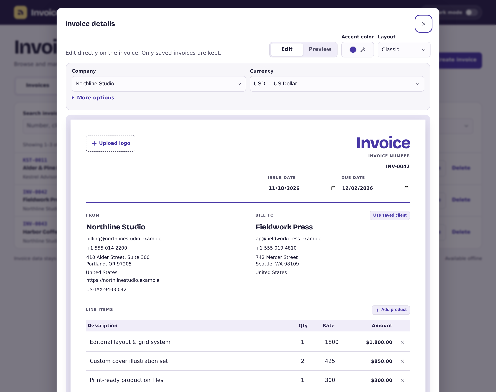
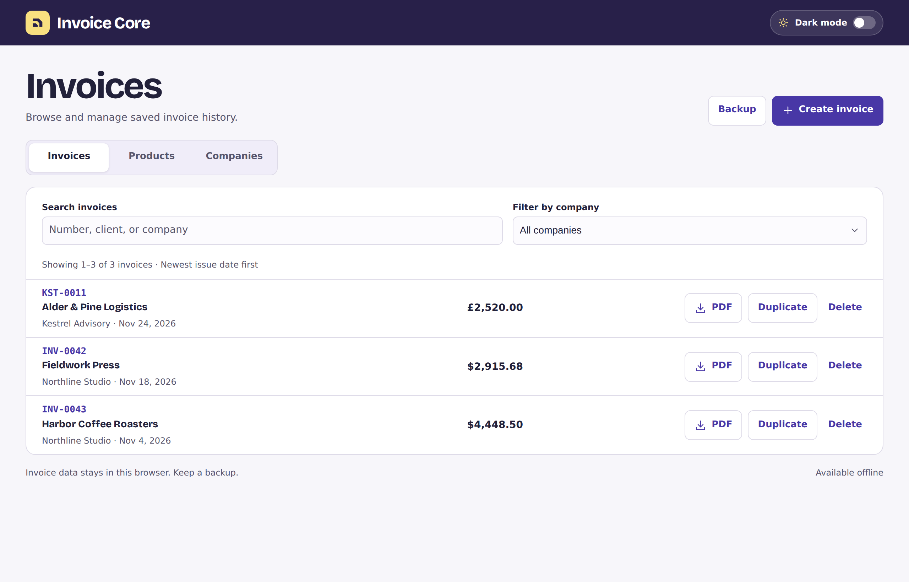
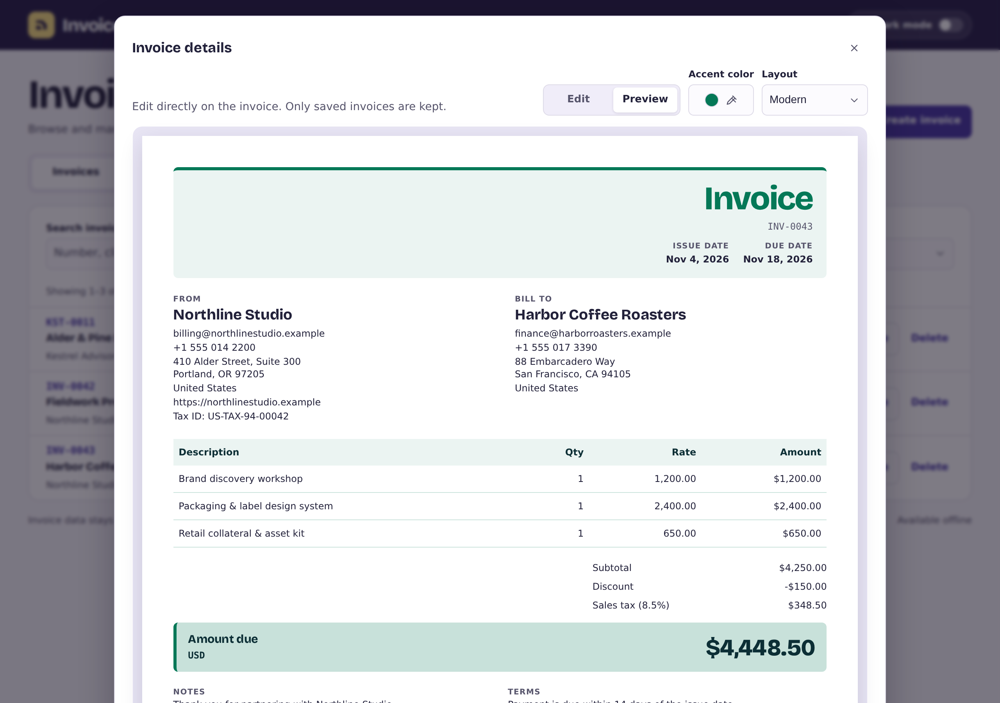
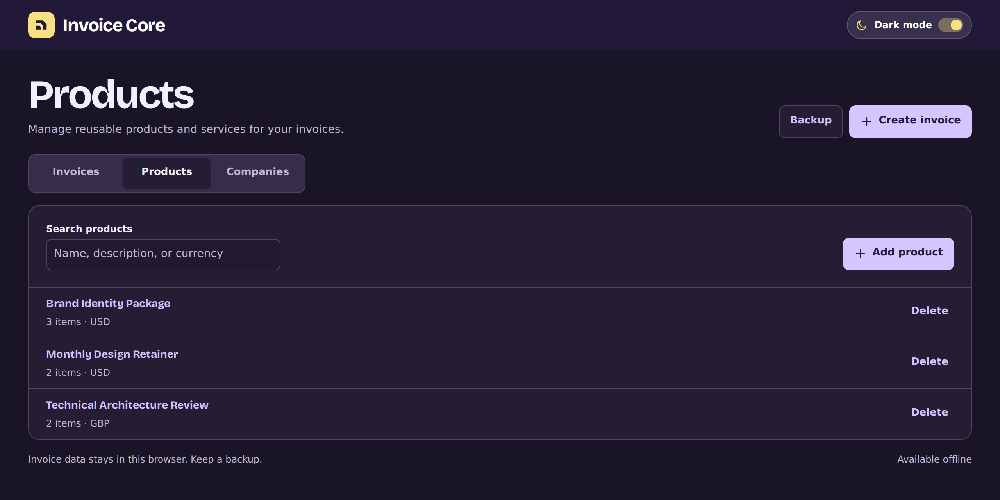
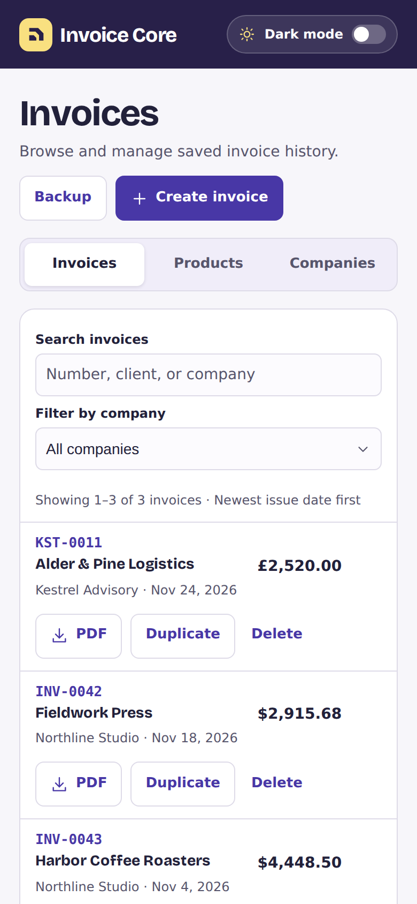
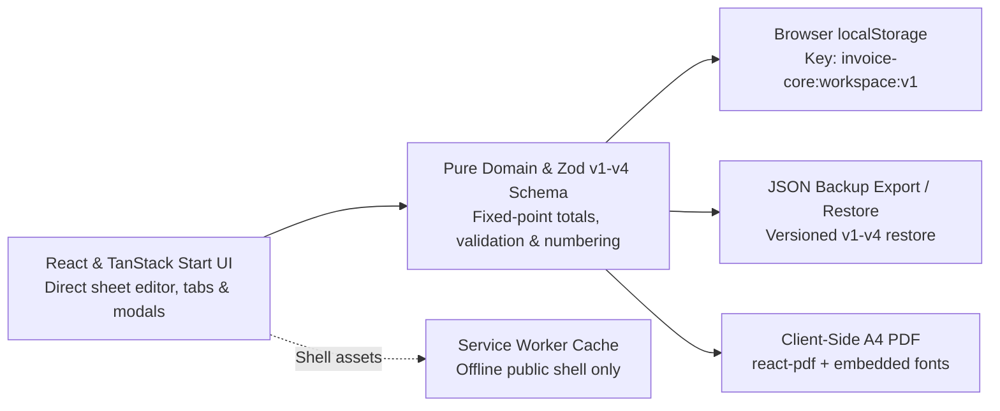

# Invoice Core

A local-first invoice editor with direct editing on the invoice sheet, downloadable A4 PDF, reusable company profiles, and searchable history. There is no login, server database, or cloud sync.

[](https://invoice.achmadya.dev)
[](https://github.com/achmadya-dev/invoice-core/actions/workflows/ci.yml)
[](LICENSE)
[](.bun-version)

> [!NOTE]
> **Reference template:** Invoice Core was bootstrapped from [`achmadya-dev/ai-project-template`](https://github.com/achmadya-dev/ai-project-template) and adapted into a browser-local workspace by retiring the inherited authentication and server database stack (see [ADR 0003](docs/adr/0003-browser-local-invoice-workspace.md)). It also serves as a working reference for an AI-assisted TanStack Start, Bun, and Nitro codebase verified end-to-end with unit, policy, smoke, and Playwright browser checks.

<p align="center">
  
  <br>
  <em>Edit directly on the paper-framed invoice sheet with company defaults, saved clients, and multi-line product groups.</em>
</p>

## Visual preview

All screenshots below are captured from a built production instance populated with the synthetic workspace in [`docs/examples/sample-workspace.v4.json`](docs/examples/sample-workspace.v4.json). See [`docs/images/README.md`](docs/images/README.md) for capture details and update policy.

<table>
  <tr>
    <td width="50%" valign="top">
      <strong>Workspace &amp; searchable history</strong><br>
      Filter by company or query, download PDFs directly from rows, duplicate invoices, or click any row to view and edit.<br><br>
      
    </td>
    <td width="50%" valign="top">
      <strong>A4 document preview &amp; custom layouts</strong><br>
      Switch between Classic, Modern, and Minimal layouts with custom hex accent colors and live read-only document proof.<br><br>
      
    </td>
  </tr>
  <tr>
    <td width="50%" valign="top">
      <strong>Reusable product groups &amp; dark mode</strong><br>
      Define multi-line service bundles across currencies and toggle light or dark theme from the topbar switch.<br><br>
      
    </td>
    <td width="50%" valign="top">
      <strong>Responsive mobile workspace</strong><br>
      Browse invoices, trigger PDF downloads, duplicate drafts, and inspect totals cleanly on narrow viewports.<br><br>
      
    </td>
  </tr>
</table>

## Features

- **Direct on-sheet editor:** Type directly onto the invoice paper for numbers, dates, sender/client info, line items, notes, terms, and payment details, or upload an inline PNG/JPEG logo in the header.
- **Click-to-open records:** Click any saved invoice, product, or company row to open it for viewing and editing without extra row clutter.
- **Layouts, theme & styling:** Follow your system color scheme by default or toggle light/dark appearance from the topbar **Dark mode** switch (while keeping a crisp white A4 sheet), and pair `Classic`, `Modern`, or `Minimal` layouts with any custom 6-digit hex accent color.
- **Client-side A4 PDF:** Render paginated A4 PDFs directly in the browser (**PDF** on rows, **Download PDF** inside Edit and Preview modes) with embedded Latin, Greek, and Cyrillic fonts (`Bricolage Grotesque` & `Noto Sans`).
- **Reusable catalog:** Store **Companies** (with independent number prefixes, padding, default currency, tax label/rate, and terms) and multi-line **Products** filtered by invoice currency.
- **v1–v4 JSON backup & offline support:** Export or restore validated workspace snapshots (`invoice-core:workspace:v1` key with backward-compatible v1–v4 decoding) and install the production app as an offline PWA on HTTPS or localhost.

## Example workspace

Want to try the workspace with realistic synthetic data right away (matching the screenshots above)?

1. Download [`docs/examples/sample-workspace.v4.json`](docs/examples/sample-workspace.v4.json) (includes 2 sample companies in `USD` and `GBP`, 3 multi-line product groups, and 3 saved invoices across `Classic`, `Modern`, and `Minimal` layouts).
2. Open [https://invoice.achmadya.dev](https://invoice.achmadya.dev) (or your local instance).
3. Click **Backup** at the top of the workspace, open **Restore a backup → Choose backup file**, select the downloaded JSON file, and confirm **Replace local workspace**.

> [!TIP]
> The sample file is validated against `workspaceSchema` (`version: 4`) in [`src/modules/invoice/domain/invoice.ts`](src/modules/invoice/domain/invoice.ts) and contains synthetic `.example` data only.

<details>
<summary>Sample v4 backup structure excerpt (<code>docs/examples/sample-workspace.v4.json</code>)</summary>

```json
{
  "version": 4,
  "theme": "system",
  "companies": [
    {
      "id": "11111111-1111-4111-8111-111111111101",
      "sender": {
        "name": "Northline Studio",
        "email": "billing@northlinestudio.example",
        "country": "US"
      },
      "prefix": "INV-",
      "nextNumber": 45,
      "padding": 4,
      "currency": "USD",
      "taxLabel": "Sales tax",
      "taxRate": "8.5"
    }
  ],
  "products": [
    {
      "id": "22222222-2222-4222-8222-222222222201",
      "name": "Brand Identity Package",
      "currency": "USD",
      "items": [
        { "description": "Brand discovery & positioning workshop", "quantity": "1", "rate": "1200" },
        { "description": "Primary wordmark, mark, and typography system", "quantity": "1", "rate": "2400" },
        { "description": "Digital brand guidelines PDF & asset kit", "quantity": "1", "rate": "850" }
      ]
    }
  ],
  "invoices": [
    {
      "id": "44444444-4444-4444-8444-444444444401",
      "number": "INV-0042",
      "currency": "USD",
      "layout": "classic",
      "accentColor": "#4837a6"
    }
  ]
}
```

</details>

## Architecture at a glance



All calculations and schema rules live in [`src/modules/invoice/domain/`](src/modules/invoice/domain/invoice.ts) with zero browser or server I/O. Browser adapters (`*.browser.ts`) isolate storage, file downloads, PDF generation, and offline service-worker registration at the boundary.

## Run locally

Use the Bun version in [`.bun-version`](.bun-version). Node 26 is used by the test tooling, not the application runtime.

```sh
bun install --frozen-lockfile
bun run dev
```

Open [http://127.0.0.1:3000](http://127.0.0.1:3000). No `.env` file or database setup is required.

## Use the workspace

- **Invoices:** search, create, duplicate, or click any saved row to open it for viewing and editing. Edit directly on the sheet, switch to **Preview** for the read-only document, or use **Create invoice** / **Save changes** to store updates.
- **Catalog:** open **Products** (including multi-line groups) or **Companies** and click any row to view or update details, or click **Add product** / **Add company**. Inside an invoice, use **Use saved client** or **Add product** above the matching section, or upload a logo in the sheet header.
- **PDF:** click **PDF** on any invoice row or **Download PDF** in Edit or Preview mode to generate an A4 PDF with the embedded Latin, Greek, and Cyrillic fonts.
- **Backup:** click **Backup** to export a private JSON copy (**Download backup**), import an existing snapshot (**Restore a backup**), or clear local workspace data before moving browsers.
- **Offline:** supported browsers can install and reopen the production workspace offline after **Available offline** appears in the footer (requires HTTPS or localhost).

## Verify

```sh
bunx playwright install chromium
bun run verify
```

`bun run check` runs formatting, lint, policy tests, unit tests, the Bun build, and type checks. `bun run verify` also runs browser E2E tests, the production route smoke test, and the offline suite. See [verification](docs/VALIDATION.md) for the individual checks.

## Run a production build locally

```sh
bun run build
HOST=127.0.0.1 PORT=3000 bun run start
```

Alternatively, build the standalone image with `docker build -t invoice-core .` and run `docker run --rm -p 127.0.0.1:3000:3000 invoice-core`. The container serves the application; browser-local invoices are never stored in the container. Follow the [recovery runbook](docs/runbooks/RECOVERY.md) for origin changes and rollbacks.

## Development

Start with [the development guide](START_HERE.md) and [repository instructions](AGENTS.md). See [product scope](docs/PRODUCT.md), [invoice rules](docs/DOMAIN.md), [architecture](docs/ARCHITECTURE.md), and [design](docs/DESIGN.md) before changing behavior.

## Contributing

Contributions are welcome. Read the [contributing guide](CONTRIBUTING.md) and [code standards](docs/CODE_STANDARDS.md) before opening a pull request.

## Security

Invoice Core keeps all workspace data in the current browser profile. See the [security policy](SECURITY.md) for reporting vulnerabilities privately.

## License

Licensed under the [MIT License](LICENSE). Embedded fonts ship under the SIL Open Font License in [`public/licenses/`](public/licenses/OFL-Bricolage-Grotesque.txt).
